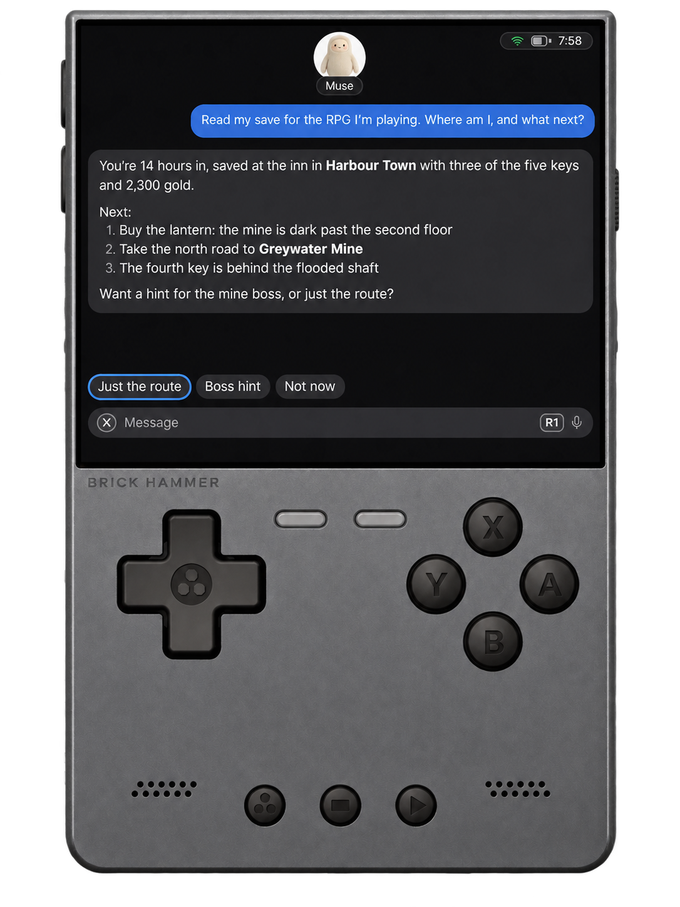
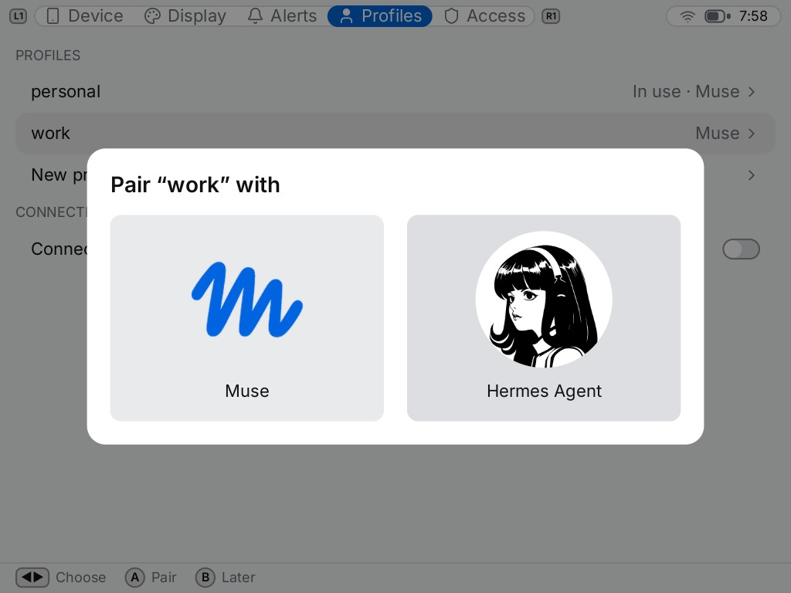
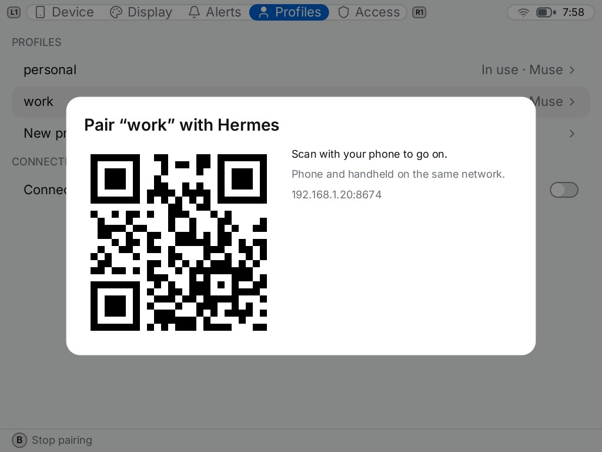
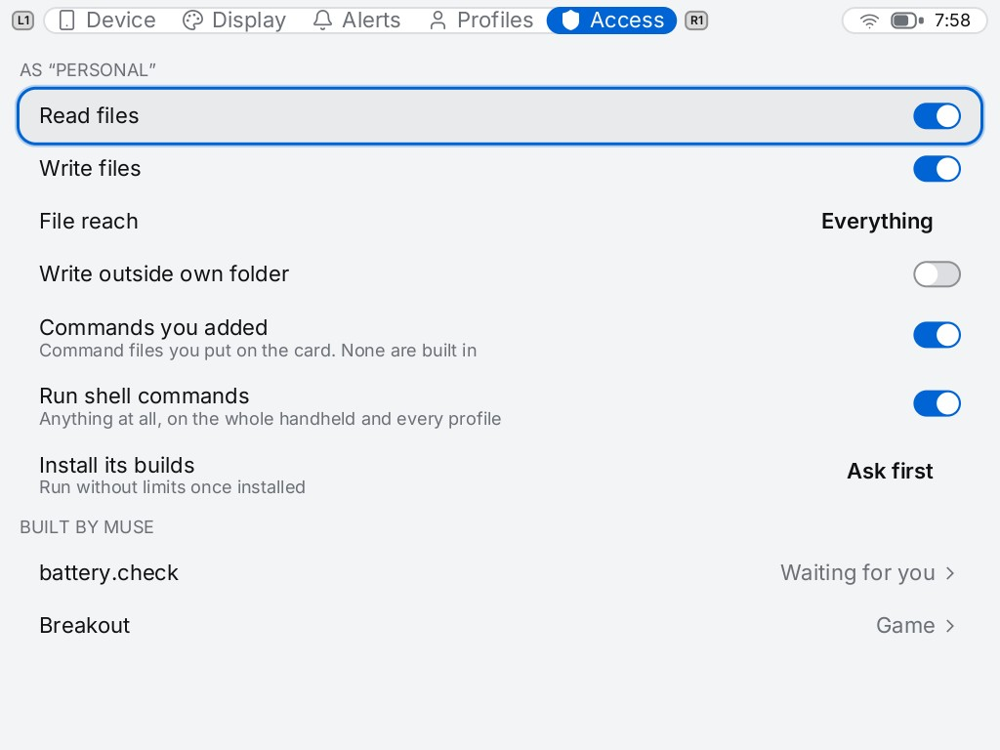
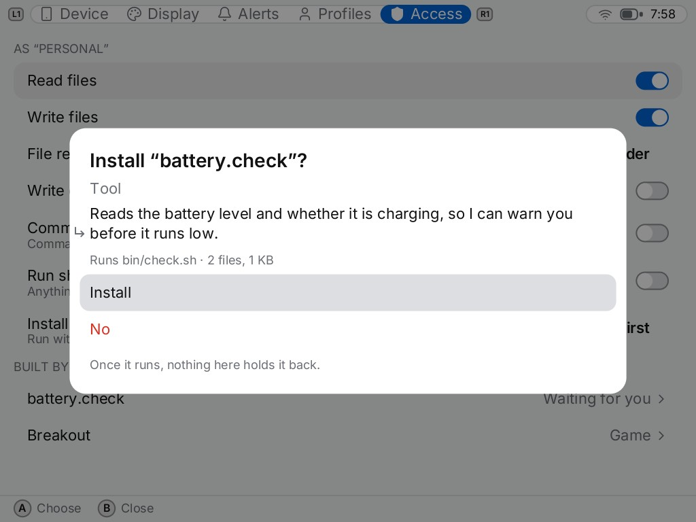

# Goblin Link

Your AI agent on a TrimUI Brick: **Muse**, or a **Hermes Agent** you run yourself. Chat and
talk with it, and let it act on the handheld as far as you allow.

<p align="center">
  
  
</p>

**[Download the latest release](https://github.com/travis-mcdevitt/goblin-link/releases/latest)**
· Not made by, affiliated with or endorsed by Meta ([details](#licence-and-credits)).

- **Chat** with your agent, in a main chat and side chats, with pictures and clips in replies.
- **Voice notes:** hold R1 and talk.
- **Calls** (Muse only).
- **Alerts:** lights and vibration when a reply arrives while the app is closed.
- **Profiles:** several agents or accounts on one handheld, each with its own chats, files
  and permissions.
- **Builds for the handheld:** your agent can write tools for itself, and apps and games
  that appear under **Tools**, and install them when you say yes.
- **You decide what it may do:** read or write files and how far, run shell commands, run
  your own commands. A new profile can only use its own folder and asks before installing.

| Chat | Pair | Hermes | Access | Install |
|---|---|---|---|---|
|  |  |  |  |  |

## Works on

| Device | State |
|---|---|
| TrimUI Brick, NextUI | Works; used daily by its author |
| TrimUI Brick Pro, Smart Pro, NextUI | Untried: [testers wanted](CONTRIBUTING.md#testing-on-a-device-nobody-has-tried) |
| Other handhelds | Not yet: see [platforms/](platforms/README.md) |

It is early software: see [known issues](docs/known-issues.md).

## Install

**Pak Store:** look for Goblin Link under Tools (once it is listed).

**By hand:** download `Goblin.Link.pak.zip` from
[Releases](https://github.com/travis-mcdevitt/goblin-link/releases/latest), unzip it into a
folder named `Goblin Link.pak`, and copy that to `Tools/tg5040/` on the SD card. Use that
name, with a space: the Pak Store installs there too, so its updates replace your copy
instead of adding a second entry.

To update, install over the old folder and open the app once. Profiles and pairings are
kept. **Connect when the handheld starts** is off after a fresh install.

## Pair

Open **Tools → Goblin Link**, press A, and choose your agent:

- **Muse:** scan the QR code with your phone, save an SDK token from your Muse account, then
  add the handheld in the Muse app over Bluetooth.
- **Hermes Agent:** install [the plugin](hermes-plugin/README.md) on your Hermes, send it
  `/goblinlink pair`, and paste the link it answers with on the page your phone opened.

Step by step, with tokens, profiles and what to do when it fails: [docs/pairing.md](docs/pairing.md).

## Buttons

**Select** lists the buttons for wherever you are.

| Button | In the chat |
|---|---|
| X | Type |
| Hold R1 | Talk: sends a voice note when you let go |
| Start | Send what you typed |
| A | Select |
| L2 / R2 | Scroll |
| D-pad left | Your chats |
| B | Back to the newest message, or to the main chat |
| Y | Hermes: its commands, and Stop while it replies |
| F2 | Muse: call; on a call, R1 mutes and F2 hangs up |
| Menu | Settings, and the two ways out: stay connected, or disconnect |

When your agent asks for something, its card shows the answers: **A** yes, **B** no, and
sometimes **Y** for an hour.

## Things to try

What works depends on **Settings → Access**. Each idea says what it needs.

- **Ask about your games** (read files, reach: SD card): "Read my Zelda save and tell me
  what to do next."
- **Let it ask** (nothing): when it needs a permission it lacks, it asks with a card.
- **Teach it a skill** (install builds): "Make yourself a tool that reports the battery
  level."
- **Have it make a game** (install builds): "Make me a breakout game for this handheld." See
  [building apps and games](docs/building-games.md).

## What you are trusting

- **Full access is the whole handheld.** With shell commands, files reaching "Everything",
  or installs on, your agent can change or delete anything on it, use whatever else is
  installed (such as Tailscale) and, with the shell, use Wi-Fi and Bluetooth.
- **Your agent acts on what it reads,** so a web page or a message could talk it into using
  whatever you allowed. Turn on only what you need.
- **A lost handheld has no lock.** Whoever holds it can talk to your agent as you. Remove the
  device in the Muse app, or `/goblinlink unpair` it on your Hermes.
- **A handheld paired with Hermes is a full user of your Hermes.**

**Your data:** profiles, tokens, cached chats and the command log are on the SD card in
`.userdata/tg5040/goblin-link`, and each profile's files are in `GoblinLink`. The card is
FAT, so anyone who has it can read them. What you say and send goes to the agent the profile
is paired with.

Read [SECURITY.md](SECURITY.md) before you turn on more than reading files.

## Uninstall

1. **Settings → Profiles:** turn off **Connect when the handheld starts**, then unpair every
   profile.
2. Remove the device in the Muse app (**Settings → Devices**), or send your Hermes
   `/goblinlink unpair <id>` (`/goblinlink devices` lists them).
3. **Settings → Access:** remove what your agent built. This also takes its apps and games
   out of **Tools**.
4. Remove Goblin Link in the Pak Store, or delete `Tools/tg5040/Goblin Link.pak`.
5. Restart the handheld.
6. Delete `.userdata/tg5040/goblin-link` and `GoblinLink` from the SD card. Your own
   commands are in `/mnt/UDISK/goblin-link` on internal storage, which needs a shell to
   remove. Installs from before the rename used `.userdata/tg5040/musegadget`, `Muse` and
   `/mnt/UDISK/muse-gadget`.

## Building and contributing

```sh
cargo run --release -p goblin-ui     # the app with made-up data, in a window on a PC
tools/test-in-container.sh           # the tests, in Docker
```

Cross-building for the Brick and packaging: [docs/building.md](docs/building.md). How to
help: [CONTRIBUTING.md](CONTRIBUTING.md).

| Part | What it is |
|---|---|
| `goblind` | The daemon: the link to your agent, commands under your permissions, chats |
| `goblin-ui` | The app, an SDL2 program that draws its own interface |
| `goblinctl` | A command line for the same things |
| `crates/muse-*` | Muse: wire protocol, client, Bluetooth pairing |
| `crates/hermes-link`, `hermes-plugin/` | Hermes: the handheld's client, and the plugin Hermes loads |
| `crates/goblin-ui-kit` | Drawing: text, widgets, focus, GPU sprites |
| `platforms/` | One folder per device |

The app and the daemon talk over a local socket: [docs/ipc.md](docs/ipc.md).

## Made with AI assistants

This project is built with AI coding agents (Claude, by Anthropic, and Codex, by OpenAI).
They work from issues in this repository, a second agent reviews each change, and its author
tests it on a real TrimUI Brick.

## Licence and credits

Apache-2.0: see [LICENSE](LICENSE) and [NOTICE](NOTICE), which also cover the fonts and
icons.

Goblin Link speaks the protocol of Meta's open-source
[Muse Gadget SDK](https://github.com/facebookincubator/muse-gadget-sdk), and parts of it are
a Rust port of that SDK. It is an independent project, **not made by, affiliated with or
endorsed by Meta**. "Muse" is used only to say what it works with.
[Hermes Agent](https://github.com/NousResearch/hermes-agent) is by Nous Research.
