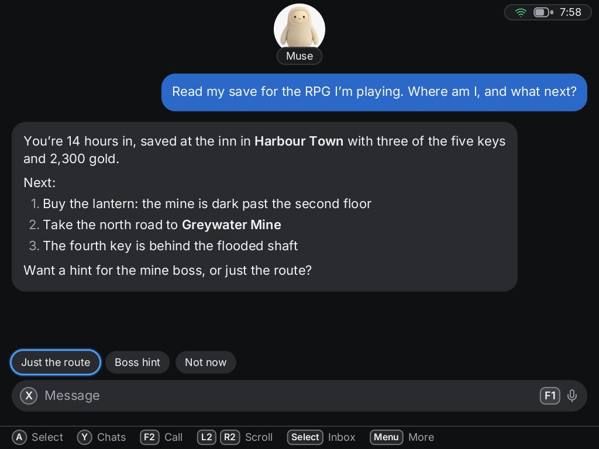
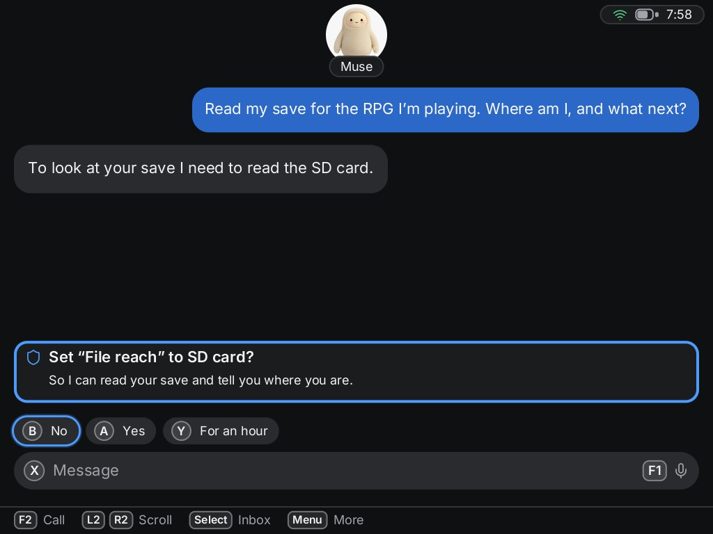
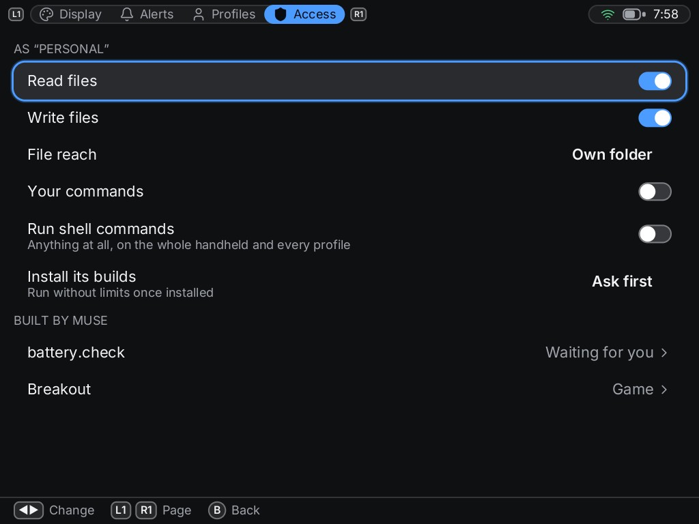

# Goblin Link for Linux handhelds

A Muse client for small Linux game handhelds. It turns the handheld into a *Muse gadget*: a
device your Muse can talk to you through and, where you allow it, act on. Muse is the only
agent it works with today; the crates that speak Muse's protocol (`muse-proto`, `muse-link`,
`muse-pair`) are kept apart from the rest so another agent can be added beside it.

- **Chat** with your Muse, main chat and side chats, with pictures and clips in replies.
- **Voice notes** (hold a button and talk) and **calls**.
- **Alerts**: lights and vibration when a reply arrives while the app is closed.
- **Several Muse accounts** on one handheld, each as its own profile with its own chats,
  files and permissions.
- **Pairing from the handheld**, over Bluetooth, with the Muse app on your phone.
- **Muse can build for the handheld**: tools it can call here, and apps and games that
  appear in the launcher. It builds on its own computer and installs the result, if you
  allow it, and can remove only what it installed.
- **You decide what Muse may do on the device**: read or write files (and how far they
  reach), run shell commands, run commands you wrote yourself. A new profile starts with
  files in its own folder and nothing else.

| Ask it about your games | It asks before it reaches further | You decide what it may do |
|---|---|---|
|  |  |  |

It speaks the protocol of Meta's open-source
[Muse Gadget SDK](https://github.com/facebookincubator/muse-gadget-sdk) and parts of it are a
Rust port of that SDK (see [NOTICE](NOTICE)). It is an independent project: **not made by,
affiliated with or endorsed by Meta**. "Muse" is used only to say what it works with.

## Status

Early. It is used daily on one device by its author and has not been tried by anyone else.

| Device | Firmware | State |
|---|---|---|
| TrimUI Brick | NextUI | Works: chat, voice notes, calls, alerts, pairing (Android and iPhone), profiles |
| TrimUI Brick Pro, Smart Pro | NextUI | Untried. Platform files exist, written from NextUI's source; [testers wanted](CONTRIBUTING.md#testing-on-a-device-nobody-has-tried) |
| Other handhelds | — | Not yet. A device is described by one file and a few scripts: see [platforms/](platforms/README.md) |

Known gaps are listed in [docs/known-issues.md](docs/known-issues.md).

## Install on a TrimUI Brick (NextUI)

1. Download `Goblin.Link.pak.zip` from the
   [releases page](https://github.com/travis-mcdevitt/goblin-link/releases) and unzip it.
2. Name the unzipped folder `Goblin Link.pak` (your computer may have called it
   `Goblin.Link.pak`) and copy it to `Tools/tg5040/` on the SD card.
3. On the Brick, open **Tools → Goblin Link** and press A to pair.
4. Scan the code on the Brick with your phone. On the page that opens, tap **Get a token**
   (Meta's site opens in a new tab), copy the token, come back and paste it.
5. The Brick moves on to Bluetooth pairing by itself: in the Muse app, go to Settings →
   Devices → +, and choose the name the Brick shows. You need Developer mode on in the Muse
   app (Settings → Devices), because this is a community device.

### About the SDK token

Meta issues SDK tokens to Muse account holders at
[gadgets.muse.ai/settings/sdk-tokens](https://gadgets.muse.ai/settings/sdk-tokens); this
project does not come with one and cannot give you one. They come with Meta's
[Gadget SDK Token Terms of Use](https://gadgets.muse.ai/sdk-terms): among other things,
tokens are for personal, non-commercial use with your own Muse account.

Meta's page lets you have one active token and shows it in full only when it is generated;
afterwards it shows just the first few characters. Keep a copy somewhere safe: the same
token works for every handheld and profile you pair to that account. Generating a new one
means revoking the old, which unlinks the devices that used it.

The page you paste into is served by the Brick itself, over plain HTTP on your own Wi-Fi,
only while that screen is open. If the phone and the Brick are not on the same network,
save the token in a file named `sdk_token.txt` in the `GoblinLink` folder on the SD card
instead, then pair.

To build it yourself, see [docs/building.md](docs/building.md).

## Things to try

What your Muse can do here depends on what you allow in **Settings → Access**. Each idea
says what it needs.

**Ask about your games.** *Needs: Read files, with "File reach" set to SD card.*
Your saves are on the card, so your Muse can read them. One that worked: "Read my Zelda
Game Boy save and tell me where I am and what to do next." It found the save, worked out
the progress, and gave hints. The same goes for "which of my games have I never opened?"
or "back up my saves into your folder" (that one also needs Write files).

**Let it ask.** *Needs: nothing.* When a task needs something your Muse isn't allowed, it
can ask: a card appears in the chat ("Muse asks to change "File reach" to The SD
card", with its reason) and you answer with B for no, A for yes, or Y to allow it for
an hour. It can ask the same way to change a preference, such as turning vibration off
when you say you want quiet. The widest permissions can't be asked for; you set those in
Settings yourself.

**Teach it skills.** *Needs: Install its builds.* A skill is a small program your Muse
writes on its own computer, tests there, and installs here as a tool it can call from then
on. Ask in plain words: "Make yourself a tool that reports the battery level and whether
it's charging." With the switch on **Ask first**, the request appears in the chat,
showing what it wants to install and what it runs, and nothing happens until you press A
to install it or B for no. Your Muse hears your answer straight away. Each tool is listed
under **Built by Muse** in Settings → Access, where you can remove it. Your Muse can remove
its own too, and only its own.

**Have it make you something.** *Needs: Install its builds.* The same switch covers
apps and games: "Make me a breakout game for this handheld" ends with an entry in the
launcher. How well a game runs is up to what your Muse builds; this is the newest and
least-tried part.

**Have it keep watch.** *Needs: a tool, so Install its builds.* Not tried yet, but the
pieces are there: a tool that checks something (battery, storage, a download, a web page)
and the lights and vibration the handheld already uses for replies. Sound cues are
possible in principle, since a tool is a program like any other.

**Connect things to it.** *Needs: a tool, or the shell.* Also not tried: the Brick has a
second USB port, and a tool your Muse builds could talk to what is plugged into it (a
sensor, a serial device, a controller).

Before turning on more than file reading, read the next section.

## What you are trusting

Pairing gives this software a device token for your Muse account, kept on the SD card, and
gives your Muse a way to run the commands you have switched on.

**Full access means the whole handheld.** If you turn on shell commands, let files reach
"Everything" with writing on, or let Muse install what it builds, your Muse can:

- **Change or delete anything on it**: your games and saves, and the operating system's own
  files. A mistake there can leave the handheld unable to start until you reinstall it.
- **Use whatever else is installed.** If the handheld runs something like Tailscale, your
  Muse can use it to reach the other devices on that network.
- **Use the radios** (shell commands only): scan for and join Wi-Fi networks, and use
  Bluetooth.

A new profile starts with none of this: files in its own folder only, no shell. Turn on more
in **Settings → Access** only for what you need, and remember that Muse acts on what it
reads, so a web page or message could talk it into using whatever you have allowed.

**A lost handheld has no security.** There is no PIN or lock: whoever holds it can talk to
your Muse as you, and through it reach whatever your Muse is connected to (email and other
linked accounts). If it goes missing, remove the device in the Muse app straight away. Read
[SECURITY.md](SECURITY.md) before pairing an account you care about.

## How it is put together

| Part | What it is |
|---|---|
| `goblind` | The daemon: keeps the link to Muse, runs commands under your permissions, keeps chats |
| `goblin-ui` | The app: an SDL2 program that draws its own interface |
| `goblinctl` | Command line for the same things, for scripts and testing |
| `crates/muse-proto`, `muse-link`, `muse-pair` | The wire protocol, the client, and Bluetooth pairing |
| `crates/goblin-ui-kit` | The drawing kit: text, widgets, focus, and GPU sprites |
| `platforms/` | One folder per device: what hardware it has and how to drive it |

The app and the daemon talk over a local socket; the protocol is in [docs/ipc.md](docs/ipc.md).

## Licence

Apache-2.0. See [LICENSE](LICENSE) and [NOTICE](NOTICE) for the SDK port, fonts and icons.
