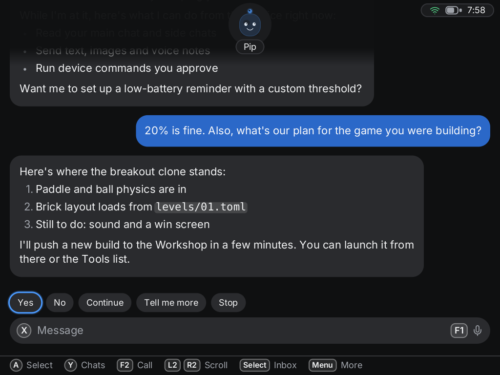
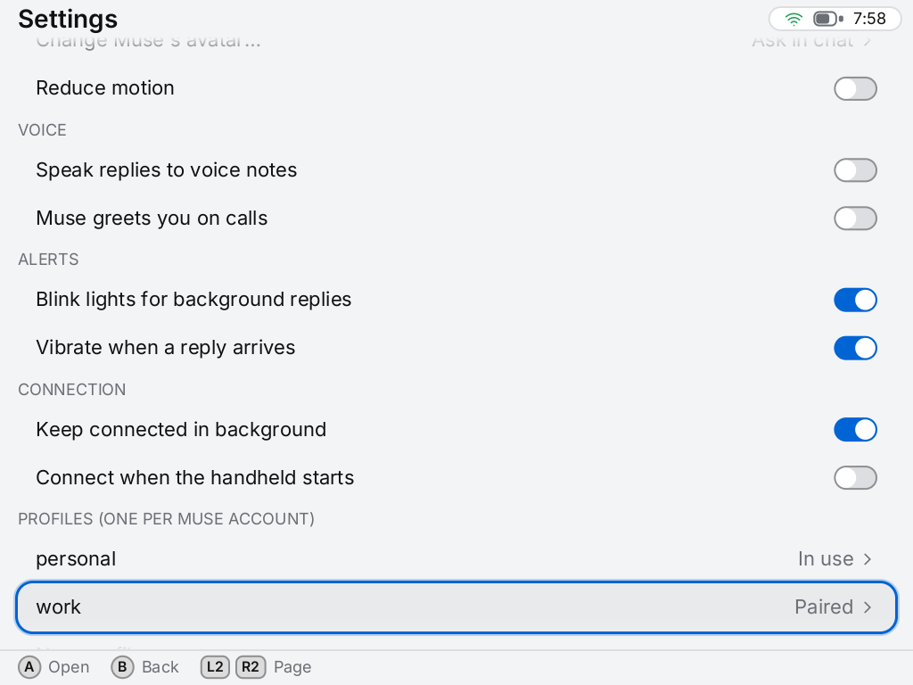
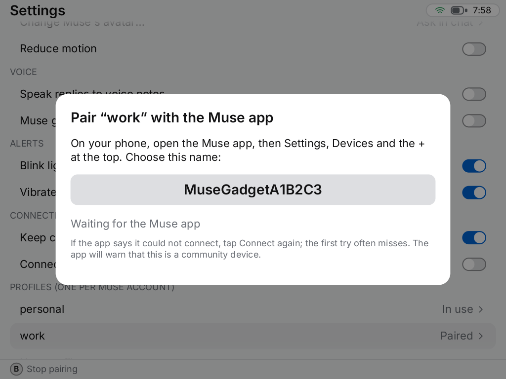

# Goblin Link for Linux handhelds

A Muse client for small Linux game handhelds. It turns the handheld into a *Muse gadget*: a
device your Muse can talk to you through and, where you allow it, act on. Muse is the only
agent it works with today; the crates that speak Muse's protocol (`muse-proto`, `muse-link`,
`muse-pair`) are kept apart from the rest so another agent can be added beside it.

- **Chat** with your Muse, main chat and side chats, with pictures and clips in replies.
- **Voice notes** (hold a button and talk) and **calls**.
- **Alerts**: lights and vibration when a reply arrives while the app is closed.
- **Several Muse accounts** on one handheld, each as its own profile with its own chats,
  files and permissions.
- **Pairing from the handheld**, over Bluetooth, with the Muse app on your phone.
- **You decide what Muse may do on the device**: read or write files (and how far they
  reach), run shell commands, run commands you wrote yourself. A new profile starts with
  files in its own folder and nothing else.

| Chat | Profiles | Pairing |
|---|---|---|
|  |  |  |

It speaks the protocol of Meta's open-source
[Muse Gadget SDK](https://github.com/facebookincubator/muse-gadget-sdk) and parts of it are a
Rust port of that SDK (see [NOTICE](NOTICE)). It is an independent project: **not made by,
affiliated with or endorsed by Meta**. "Muse" is used only to say what it works with.

## Status

Early. It is used daily on one device by its author and has not been tried by anyone else.

| Device | Firmware | State |
|---|---|---|
| TrimUI Brick | NextUI | Works: chat, voice notes, calls, alerts, pairing, profiles |
| Other handhelds | — | Not yet. A device is described by one file and a few scripts: see [platforms/](platforms/README.md) |

Known gaps are listed in [docs/known-issues.md](docs/known-issues.md).

## Install on a TrimUI Brick (NextUI)

1. Download `goblin-link-pak.zip` from the releases page and unzip it.
2. Copy the `Goblin Link.pak` folder to `Tools/tg5040/` on the SD card.
3. On the Brick, open **Tools → Goblin Link**.
4. In the app: **Menu → Settings**, choose your profile, then **Pair with the Muse app**
   and follow the steps on screen. You need the Muse app on a phone with Developer mode on
   (Settings → Devices), because this is a community device.

To build it yourself, see [docs/building.md](docs/building.md).

## What you are trusting

Pairing gives this software a device token for your Muse account, kept on the SD card, and
gives your Muse a way to run the commands you have switched on. Read
[SECURITY.md](SECURITY.md) before pairing an account you care about.

## How it is put together

| Part | What it is |
|---|---|
| `goblind` | The daemon: keeps the link to Muse, runs commands under your permissions, keeps chats |
| `goblin-ui` | The app: an SDL2 program that draws its own interface |
| `goblinctl` | Command line for the same things, for scripts and testing |
| `crates/muse-proto`, `muse-link`, `muse-pair` | The wire protocol, the client, and Bluetooth pairing |
| `crates/goblin-ui-kit` | The drawing kit: text, widgets, focus, and GPU sprites |
| `platforms/` | One folder per device: what hardware it has and how to drive it |

The app and the daemon talk over a local socket; the protocol is in [docs/ipc.md](docs/ipc.md).

## Licence

Apache-2.0. See [LICENSE](LICENSE) and [NOTICE](NOTICE) for the SDK port, fonts and icons.
