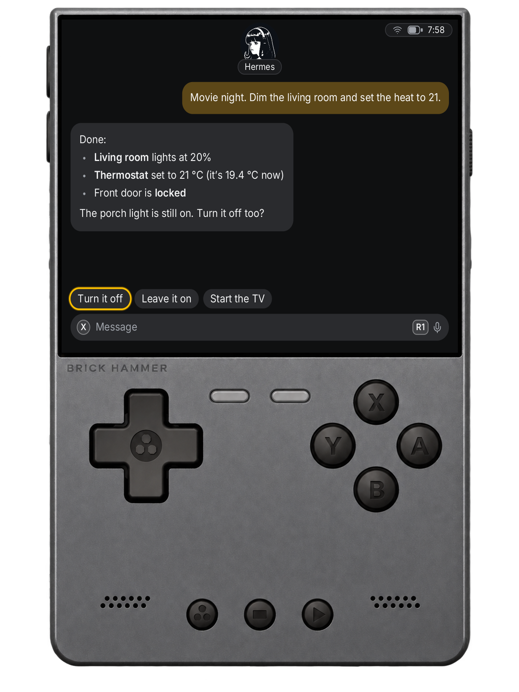
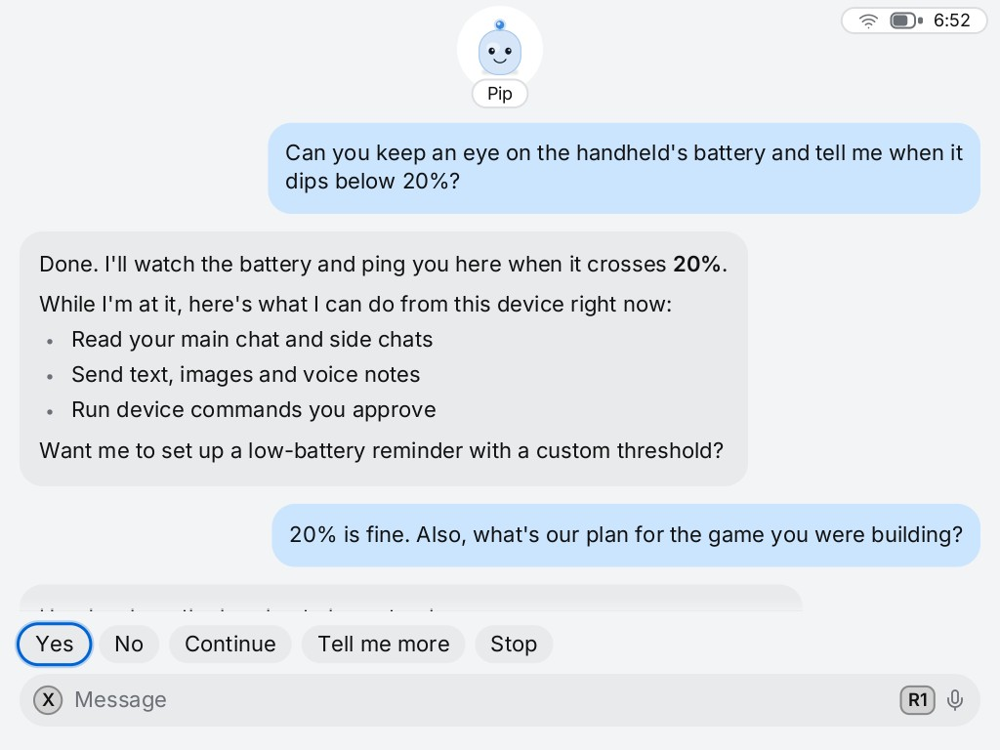
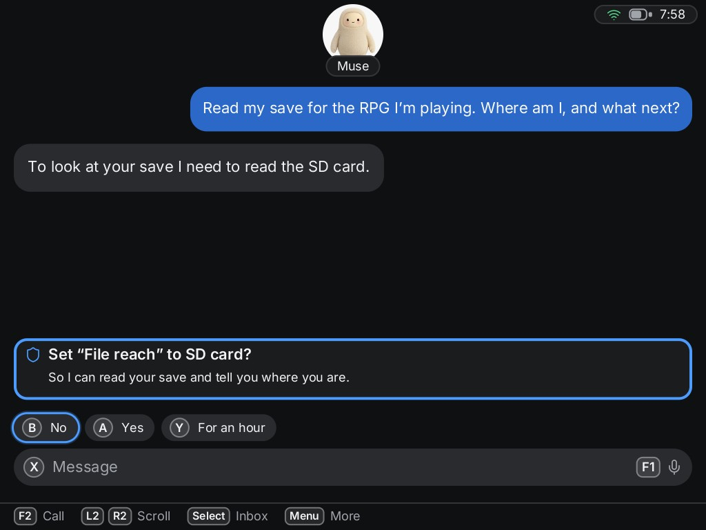
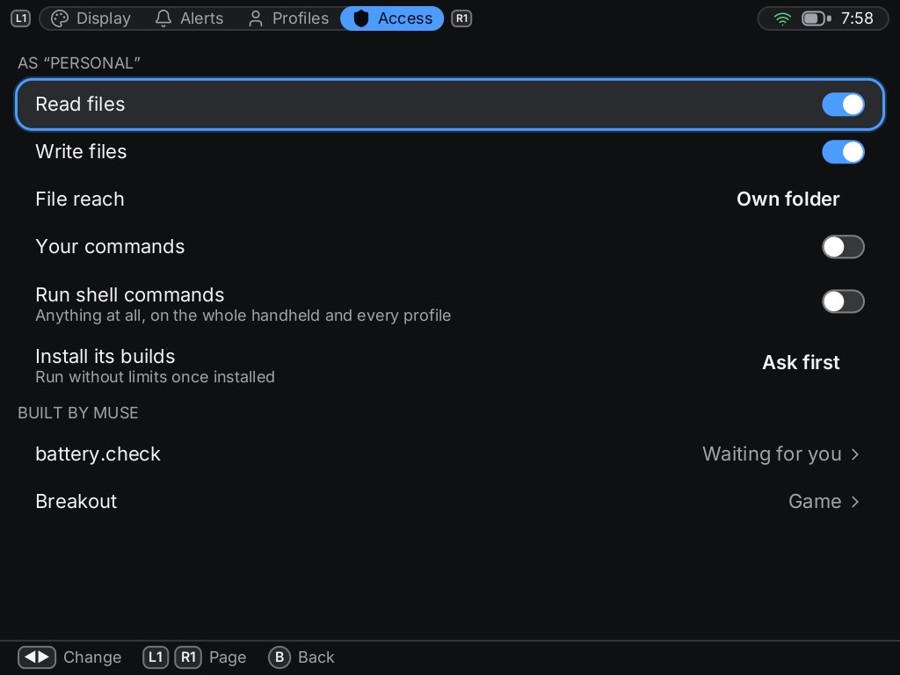

# Goblin Link for Linux handhelds

  
  

**[Latest release candidate: v0.1.0-rc.2](https://github.com/travis-mcdevitt/goblin-link/releases/tag/v0.1.0-rc.2)** · [Download for NextUI](https://github.com/travis-mcdevitt/goblin-link/releases/download/v0.1.0-rc.2/Goblin.Link.pak.zip)

A client for small Linux game handhelds that puts your AI agent on the device: something it
can talk to you through and, where you allow it, act on. It works with two kinds of agent,
one per profile: **Muse** (the handheld becomes a *Muse gadget*), or a **Hermes Agent** you run
yourself. Most of what follows is written for Muse; what differs for a Hermes is in
[its own section](#using-a-hermes-agent-instead-of-a-muse).

- **Chat** with your Muse, main chat and side chats, with pictures and clips in replies.
- **Voice notes** (hold a button and talk) and **calls**.
- **Alerts**: lights and vibration when a reply arrives while the app is closed.
- **Several Muse accounts** on one handheld, each as its own profile with its own chats,
  files and permissions.
- **Pairing from the handheld**, over Bluetooth, with the Muse app on your phone.
- **Muse can build for the handheld**: tools it can call here, and apps and games that
  appear in the launcher. It builds on its own computer and installs the result, if you
  allow it, and can remove only what it installed.
- **You decide what Muse may do on the device**: read or write files (and how far they
  reach), run shell commands, run commands you wrote yourself. A new profile starts with
  files in its own folder and **Ask first** for installing its builds.

| Ask it about your games | It asks before it reaches further | You decide what it may do |
|---|---|---|
|  |  |  |

It speaks the protocol of Meta's open-source
[Muse Gadget SDK](https://github.com/facebookincubator/muse-gadget-sdk) and parts of it are a
Rust port of that SDK (see [NOTICE](NOTICE)). It is an independent project: **not made by,
affiliated with or endorsed by Meta**. "Muse" is used only to say what it works with.

## Status

Early. It is used daily on one device by its author and has not been tried by anyone else.

| Device | Firmware | State |
|---|---|---|
| TrimUI Brick | NextUI | Works: chat, voice notes, calls, alerts, pairing (Android and iPhone), profiles |
| TrimUI Brick Pro, Smart Pro | NextUI | Untried. Platform files exist, written from NextUI's source; [testers wanted](CONTRIBUTING.md#testing-on-a-device-nobody-has-tried) |
| Other handhelds | — | Not yet. A device is described by one file and a few scripts: see [platforms/](platforms/README.md) |

Known gaps are listed in [docs/known-issues.md](docs/known-issues.md).

## Install on a TrimUI Brick (NextUI)

1. Download `Goblin.Link.pak.zip` from the
   [latest release](https://github.com/travis-mcdevitt/goblin-link/releases/latest) and unzip it.
2. Name the unzipped folder `Goblin Link.pak` (your computer may have called it
   `Goblin.Link.pak`) and copy it to `Tools/tg5040/` on the SD card.
3. Connect the handheld to Wi-Fi with internet access. Put your phone on the same
   network, then open **Tools → Goblin Link** and press A to pair.
4. Scan the QR code with your phone. The page walks you through **Get an SDK token →
   Save it on the handheld → Pair in Muse**. Reuse your saved token for this Muse account,
   or open **Get or manage SDK tokens**, copy one, and return to the page. Tap **Save token**.
5. With Bluetooth on, open **Muse → Settings → Devices** on your phone. Enable
   **Developer mode**, tap **+**, and choose the device shown on the handheld. Keep its
   pairing screen open. If Muse asks for Wi-Fi, choose the handheld’s current network.
   Saving the token alone does not complete pairing.

If the page will not open, check that both devices are on the same local network and that
its guest-network settings allow devices to reach each other. The QR screen also shows an
address you can enter manually. If pairing fails, correct the connection and press **A**
to retry, or **B** to go back. “Can’t reach Muse” means the local connection exists but
Muse could not be reached; it does not necessarily mean Wi-Fi is disconnected.

### About the SDK token

Meta issues SDK tokens to Muse account holders at
[gadgets.muse.ai/settings/sdk-tokens](https://gadgets.muse.ai/settings/sdk-tokens); this
project does not come with one and cannot give you one. They come with Meta's
[Gadget SDK Token Terms of Use](https://gadgets.muse.ai/sdk-terms): among other things,
tokens are for personal, non-commercial use with your own Muse account.

Goblin Link stores **one SDK token per profile**, not one for the entire handheld.
Profiles can store the same token or different tokens; they keep separate device identities,
pairings, chat caches and permissions. Reuse your saved token when pairing another profile
to the same Muse account. Muse limits how many devices can use a token, and each paired
profile is a separate device. A token is not a replacement for pairing each profile.

Keep a copy somewhere safe. Replacing or revoking a token can disconnect the devices
paired with it. Saving a different token alone does not update an existing pairing;
pair that profile again with the new token.

To switch, press **Menu**, go to **Profiles** with R1, select the profile with A,
and choose **Use**. Only one profile connects at a time. Switching restarts the daemon
and reconnects the app; wait for that to finish before switching again. An unpaired
profile stays unpaired when selected. Cancel an open pairing window before switching.

The page you paste into is served by the Brick itself, over plain HTTP on your own Wi-Fi,
only while that screen is open. If the phone and the Brick are not on the same network,
save the token in a file named `sdk_token.txt` in the `GoblinLink` folder on the SD card
instead, then pair.

### Using a Hermes Agent instead of a Muse

A profile can use a self-hosted [Hermes Agent](https://github.com/NousResearch/hermes-agent)
as its agent. Install the plugin on the machine Hermes runs on (see
[hermes-plugin/README.md](hermes-plugin/README.md)). On the handheld, add a profile and choose
**Hermes Agent**; scan the code it shows, send your Hermes `/goblinlink pair` in a private
chat, and paste the link it answers with on the page your phone opened. You can name the
profile there too. No Bluetooth step follows. The Brick must be able to reach that machine:
on the same network, or over a VPN such as Tailscale.

Chat, voice notes, side chats and the handheld's commands work as with a Muse, under the same
switches, and replies to voice notes can be spoken with Hermes's own voice. Calls do not. In
the chat, Y lists a few of Hermes's own commands.
Read [SECURITY.md](SECURITY.md#a-profile-paired-with-a-hermes-agent) before you pair.

To build it yourself, see [docs/building.md](docs/building.md).

## Buttons

Nothing on screen lists them; **Select** does, wherever you are.

| Button | In the chat |
|---|---|
| D-pad left | Your chats (right, or A, opens the one selected) |
| X | Type |
| Hold R1 | Talk: sends a voice note when you let go |
| F2 | Call (on handhelds that have it) |
| L2 / R2 | Scroll |
| Menu | Settings. Its first page has the two ways out: leave and stay connected, or leave and disconnect |

## Things to try

What your Muse can do here depends on what you allow in **Settings → Access**. Each idea
says what it needs.

**Ask about your games.** *Needs: Read files, with "File reach" set to SD card.*
Your saves are on the card, so your Muse can read them. One that worked: "Read my Zelda
Game Boy save and tell me where I am and what to do next." It found the save, worked out
the progress, and gave hints. The same goes for "which of my games have I never opened?"
or "back up my saves into your folder" (that one also needs Write files).

**Let it ask.** *Needs: nothing.* When a task needs something your Muse isn't allowed, it
can ask: a card appears in the chat ("Muse asks to change "File reach" to The SD
card", with its reason) and you answer with B for no, A for yes, or Y to allow it for
an hour. It can ask the same way to change a preference, such as turning vibration off
when you say you want quiet. The widest permissions can't be asked for; you set those in
Settings yourself.

**Teach it skills.** *Needs: Install its builds.* A skill is a small program your Muse
writes on its own computer, tests there, and installs here as a tool it can call from then
on. Ask in plain words: "Make yourself a tool that reports the battery level and whether
it's charging." New profiles use **Ask first**: the request appears in the chat,
showing what it wants to install and what it runs, and nothing happens until you press A
to install it or B for no. Your Muse hears your answer straight away. Each tool is listed
under **Built by Muse** in Settings → Access, where you can remove it. Your Muse can remove
its own too, and only its own.

**Have it make you something.** *Needs: Install its builds.* The same switch covers
apps and games: "Make me a breakout game for this handheld" ends with an entry in the
NextUI launcher under **Tools**, as a standalone Pak without PortMaster. How well a game runs is up to what your Muse builds; this is the newest and
least-tried part. Muse can read its own game’s latest launch output with `build.logs`
to diagnose failures. See [building apps and games](docs/building-games.md).

**Have it keep watch.** *Needs: a tool, so Install its builds.* Not tried yet, but the
pieces are there: a tool that checks something (battery, storage, a download, a web page)
and the lights and vibration the handheld already uses for replies. Sound cues are
possible in principle, since a tool is a program like any other.

**Connect things to it.** *Needs: a tool, or the shell.* Also not tried: the Brick has a
second USB port, and a tool your Muse builds could talk to what is plugged into it (a
sensor, a serial device, a controller).

Before turning on more than file reading, read the next section.

## What you are trusting

Pairing gives this software a device token for your Muse account, kept on the SD card, and
gives your Muse a way to run the commands you have switched on.

**Full access means the whole handheld.** If you turn on shell commands, let files reach
"Everything" with writing on, or let Muse install what it builds, your Muse can:

- **Change or delete anything on it**: your games and saves, and the operating system's own
  files. A mistake there can leave the handheld unable to start until you reinstall it.
- **Use whatever else is installed.** If the handheld runs something like Tailscale, your
  Muse can use it to reach the other devices on that network.
- **Use the radios** (shell commands only): scan for and join Wi-Fi networks, and use
  Bluetooth.

A new profile starts with files in its own folder only, no shell, and installs only
after you approve each one on the handheld. Turn on more
in **Settings → Access** only for what you need, and remember that Muse acts on what it
reads, so a web page or message could talk it into using whatever you have allowed.

**A lost handheld has no security.** There is no PIN or lock: whoever holds it can talk to
your Muse as you, and through it reach whatever your Muse is connected to (email and other
linked accounts). If it goes missing, remove the device in the Muse app straight away. Read
[SECURITY.md](SECURITY.md) before pairing an account you care about.

## Uninstall

Do these in order: the first steps need the app, and the last ones remove what it leaves
behind.

1. In **Settings → Profiles**, turn off **Connect when the handheld starts**. This takes
   Goblin Link out of NextUI's start-up script (`.userdata/tg5040/auto.sh`).
2. Unpair every profile in **Settings → Profiles**. Then remove the device in the Muse app
   (**Settings → Devices**), or, for a Hermes Agent, send it `/goblinlink unpair <id>`
   (`/goblinlink devices` lists them).
3. Remove what your Muse built under **Built by Muse** in **Settings → Access**. This also
   takes its apps and games out of **Tools**.
4. Uninstall Goblin Link from the Pak Store, or, if you copied it by hand, delete
   `Tools/tg5040/Goblin Link.pak` from the SD card.
5. Restart the handheld, so that nothing of Goblin Link is still running.
6. Delete its folders. On the SD card: `.userdata/tg5040/goblin-link` (profiles, pairing
   keys, tokens and logs) and `GoblinLink` (the profiles' files). On the internal storage,
   which needs a shell on the handheld: `/mnt/UDISK/goblin-link` (owner commands). An
   install from before the rename uses `.userdata/tg5040/musegadget`, `Muse` and
   `/mnt/UDISK/muse-gadget` instead.

## How it is put together

| Part | What it is |
|---|---|
| `goblind` | The daemon: keeps the link to your agent, runs commands under your permissions, keeps chats |
| `goblin-ui` | The app: an SDL2 program that draws its own interface |
| `goblinctl` | Command line for the same things, for scripts and testing |
| `crates/muse-proto`, `muse-link`, `muse-pair` | Muse: the wire protocol, the client, and Bluetooth pairing |
| `crates/hermes-link`, `hermes-plugin/` | Hermes: the handheld's client, and the plugin Hermes loads |
| `crates/goblin-ui-kit` | The drawing kit: text, widgets, focus, and GPU sprites |
| `platforms/` | One folder per device: what hardware it has and how to drive it |

The app and the daemon talk over a local socket; the protocol is in [docs/ipc.md](docs/ipc.md).

## Licence

Apache-2.0. See [LICENSE](LICENSE) and [NOTICE](NOTICE) for the SDK port, fonts and icons.
